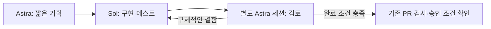

# 에이전트 역할과 실행 정책

상태: `MOMOFLOW_ROLE_FLOW=1` 순차 실행 연동과 선택적 PR 이후 연결은 운영 배포됐다.
관찰된 버전·설치 조건·검증 경계는 [운영 기록](post-pr.md)에 둔다.
현재 세션이나 실행 중인 엔진을 교체하지 않는다. 모의 계약 검사와
실제 thread/start 설정 조회는 실제 모델 호출·독립 Astra 코드 리뷰와 구분한다. 해당 PR의
정확한 head 검증 근거를 확인해야 하며 이 문서는 실운영 통과 증거가 아니다.

## 역할별 설정

| 역할 | 모델 | 추론 강도 | Fast 모드 | 산출물 |
| --- | --- | --- | --- | --- |
| 기획 | `gpt-6-astra` | `high` | OFF | 변경 범위, 완료 조건, 짧은 작업 순서 |
| 구현·수정 | `gpt-6.1-sol` | `medium` | OFF | 최소 변경, 테스트 결과, 남은 한계 |
| 검토 | `gpt-6-astra` | `high` | OFF | 실제 diff·검증 근거에 대한 구체적인 지적과 판정 |

모델은 별칭이나 그때의 기본값이 아니라 위 식별자로 지정한다. 이 배치는 초기 운영
가설이며 최적 성능·비용이 검증된 조합이라는 뜻은 아니다. 첫 이슈들의 재작업 횟수,
소요 시간, 사용량을 근거로 정책 변경을 제안한다.

## 실행 흐름과 경계

- 동시 이슈 수는 1개로 유지한다. 역할 분리는 병렬 실행 허가가 아니다.
- 검토는 구현과 별도 세션에서 수행한다. 이슈의 완료 조건, 실제 diff, 정확한 PR head와
  테스트 근거를 전달하며 구현자의 요약만으로 승인하지 않는다.
- 기획은 작은 작업에 필요한 범위로 제한한다. 검토는 실제 결함·회귀·권한 위험에 집중하며
  가상의 미래 요구 때문에 범위를 키우지 않는다. 별도 검토 세션도 필수 사람 승인을 대체하지 않는다.
- 기존 누적 최대 3회 개선 예산은 역할 전환·수정·재시작·재시도에 걸쳐 공유한다.
  각 역할마다 새 예산을 만들지 않는다. 이는 아직 하드 비용 한도가 아니다.
- Fast는 모든 역할에서 기본 OFF다. 에이전트가 속도 향상을 이유로 임의로 켜지 않는다.
- 모델·추론 강도·Fast·실행 예산 변경은 별도 정책 변경으로 제안한다. 모델을 사용할 수 없거나
  설정을 적용할 수 없으면 다른 모델이나 기본값으로 조용히 대체하지 않고 차단 사유를 기록한다.

## 부트스트랩과 실제 적용

역할별 실행 기능을 만드는 첫 작업은 기존 단일 에이전트 방식으로 수행할 수 있다.
다만 실행 전에 구현 역할의 `gpt-6.1-sol` / `medium` / Fast OFF를 명시적으로 적용하고
유효 설정을 확인해야 한다. 단일 세션의 자체 검토를 독립 Astra 검토로 표시하지 않는다.
이는 역할별 기능 도입 당시의 부트스트랩 예외다. 배포된 기능은 새 실행에 적용하며,
진행 중인 자기 엔진을 교체하지 않는다.

첫 구현에서는 Symphony가 실제로 지원하는 세션 설정·전환 지점을 먼저 확인한다.
프롬프트의 역할 선언이나 미지원 설정 필드를 추가한 것만으로 모델 전환을 구현했다고
주장하지 않는다. 일반화된 에이전트 프레임워크보다 위 순차 흐름 하나를 먼저 완성한다.

완료 조건:

- 역할별 실제 모델·추론 강도·Fast 설정과 세션 식별자를 작업 기록에 남긴다.
- 역할 전환, 별도 검토 세션, 수정 시 Sol 복귀와 공유 반복 예산을 검증한다.
- 설정 누락·지원하지 않는 모델·전환 실패 시 조용한 대체 없이 중단되는지 검증한다.
- Fast OFF가 요청 지침뿐 아니라 실제 실행 설정에 반영되는지 확인한다.
- 모의 검사, 실제 설정 조회, 실제 모델 실행 검증을 구분해 기록한다.

작업 이슈와 실행 기록은 [기록 규칙](records.md), 배포는 [배포 정책](deployment.md)을 따른다.

## 순차 실행 MVP의 동작과 한계

`engine/role_runner.ex`와 `patches/role-flow.patch`가 Symphony의 기존 세션 API를 사용한다.
기획·구현·검토·수정·게시마다 새 thread를 열고 응답의 model, reasoningEffort,
serviceTier=default, granular 승인 전부 false, workspaceWrite/networkAccess=false를 검사한다.
검토와 수정에는 이전 세션의 결과와 실제 HEAD/diff 해시를 전달한다. 게시도 Sol/medium이며
검토한 파일을 GitHub API로 PR에 보존하고 head별 검증을 기록한다. 필수 사람 리뷰를 대신하지 않는다.

기본 3회 카운터는 구현 진입 전에 증가한다. 기획·검토·게시가 새 예산을 만들지 않는다.
repo+issue별 `/data/log/roles/*.json`은 `/data` 볼륨에 남는다. 세션 시작 ID, 설정, 역할 결과와
HEAD/diff를 기록한다. 실패·중단·예산 소진·완료 ledger는 자동 재실행하지 않으며 ready 제거를
조회로 확인하고 같은 workpad에 중단 사유를 남긴다. workpad가 여러 개이거나 100개 댓글로
검색이 불완전하면 차단한다. 최신 누적 행의 기본 예산을 해석할 수 없을 때 과거 행으로 되돌리지 않는다.
이번 #2의 추가 3회는 이 기능을 만드는 부트스트랩 실행에 한정한다. 새 runner가 댓글에서 예산
확대를 승인하거나 전역 기본값을 6회로 바꾸지 않는다. 예외 이슈는 운영자 인계가 필요하다.

기획·검토·게시는 HEAD/diff 변경을 발견하면 차단한다. 이는 사후 변경 감지이며 읽기 전용
샌드박스나 GitHub 권한 분리가 아니다. 승인·네트워크 경계는 기존 설정 그대로다.
실행 중단 시 active session과 in-flight 표시를 보존한다. 자동 checkpoint 복구나 범용 PR 리뷰
이벤트 재개는 구현하지 않았다. 선택적 host inbox 수정 재개는 아래 운영 계약에 한정된다.
운영자는 ledger·workpad·PR head와 남은 예산을 확인한 후
명시적인 수동 복구를 결정하며 ledger 삭제로 예산을 초기화하지 않는다.

현재 MVP는 로컬 worker 전용이며 SSH role flow를 지원하지 않는다. `max_turns`가 lifetime
예산을 강제한다고 표현하지 않는다. 이미지 롤백 시 기존 WORKFLOW/compose 묶음을 함께
복원한다. 새 이미지에서 role flag를 잘못 지정해 단일 세션으로 돌아가는 것을 정상 role 검증으로
표시하지 않는다. 역할 모드 미지정의 단일 세션 경로는 upstream 회귀용으로 보존했다.

## GH-7 선택적 재개 계약

배포된 선택 기능의 [운영 계약](post-pr.md)은 MOMOFLOW_POST_PR_INBOX와 read-only inbox,
운영자 설치 controller가 연결된 새 역할 실행에만
적용한다. 게시의 repo/issue/PR/base/head를 runner가 검토 snapshot과 전체 Git tree에 대조하고
await_validation에 머문다. trusted host가 남긴 generation/head/실패 근거가 일치하며 기존
worker/claim이 해제된 경우에만 Sol 수정→별도 Astra 리뷰→Sol 게시로 복귀한다. 카운터는
계속 runner만 소유한다. 3번째 구현 뒤 리뷰/게시는 마칠 수 있지만 4번째 구현은 차단한다.
consumption과 build count/in_flight는 함께 저장하며 중단 실행·terminal을 자동 초기화하지 않는다.
기존 ledger의 done/blocked migration은 지원하지 않는다. 모델·Fast·승인·네트워크·동시 이슈
설정은 바꾸지 않으며 host의 병합 권한과 모델의 기술 리뷰를 분리한다.

## GH-11 후보의 작은 실행 한도

선택적 trusted launch의 설치·영속 계약·복구는 [운영 계약](post-pr.md#승인된-단일-이슈-시작-gh-11-후보-별도-설치-필요)에 둔다.
운영자가 명시한 1/2/3회 한도를 새 runner ledger에 고정하고 실제 build 진입 및 host 수정
재개에서 같은 한도를 검사한다. 마지막 허용 build 뒤 리뷰/게시는 가능하지만 다음 build는
차단한다. 한도 삭제/변경/재시작으로 기본3에 복귀하거나 초기화하지 않는다. legacy 기본3 및
기존 GH-7/GH-9 예외 기록에는 소급 적용하지 않는다. 토큰·금액 lifetime 하드 한도는 아니다.
현재 구현 세션은 배포된 기본3 계약으로 실행하며 후보 설치/live 검증은 외부 운영자의 별도 작업이다.
