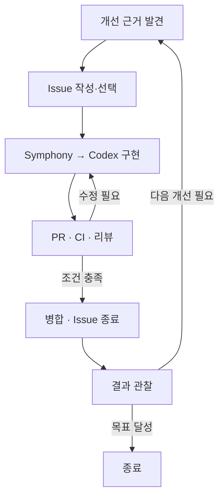

# GitHub 기반 재귀 개선 흐름

상태: 제품 운영 방식에 대한 합의. 아래의 전체 자동화가 구현된 상태는 아니다.
현재 실행 지시의 원본은 [WORKFLOW.md](../WORKFLOW.md)이며, 구현 경계는 마지막 절에 명시한다.

## 기본 흐름

일반적인 GitHub 개발 경험을 유지하면서 작업의 발견·구현·검증을 에이전트가 주도한다.
Symphony는 이슈를 실행하는 엔진이고, GitHub는 목표와 변경 및 검증 근거를 연결하는 장소다.

다음 개선이 필요하지 않거나 목표를 달성했다면 종료한다. 재귀 개선은 실행을 무한히
유지하는 것이 아니라 검증된 결과를 다음 판단에 사용하는 방식이다.

## GitHub의 역할

| 기능 | 역할 |
| --- | --- |
| Issue | 관찰한 문제, 개선 목표, 변경 범위, 완료 조건, 반복 예산 |
| 작업 기록 댓글 하나 | 계획, 반복 횟수, 검증 근거, 리뷰 지적과 해결, 현재 대기 이유 |
| Branch·PR | 한 목표에 대응하는 작고 검토 가능한 변경 |
| Actions | 반복 가능한 테스트·검증, 향후 이벤트 기반 재개 연결 |
| PR 리뷰 | 실제 diff의 목표 충족 여부와 결함 검토 |
| Merge | 검증된 변경을 기준 코드에 반영 |
| 후속 Issue | 부모 작업과 연결된 다음 개선의 관찰 근거와 완료 조건 |

에이전트의 자체 검토와 GitHub의 필수 PR 승인은 구분한다. 자체 검토로 필수 승인 조건을
충족했다고 주장하지 않는다. 검증 결과는 검사한 PR head와 함께 기록한다.
기록 위치와 이슈·PR·작업 기록 템플릿은 [기록 규칙](records.md)을 따른다.

## 첫 번째 완성 단위

목표 하나, 실행 하나, PR 하나로 시작한다. 최초의 완료 기준은 **작은 이슈 하나가
사람의 단계별 개입 없이 구현·PR·검증·병합까지 도달하는 것**이다.

1. 사용자는 큰 목표와 허용 범위를 정한다. 에이전트는 그 안에서 가장 작은 개선을 선택한다.
2. 기존 이슈와 PR을 확인해 중복 작업을 피하고, 관찰 근거와 완료 조건을 명시한다.
3. Codex가 구현하고 해당 변경에 필요한 검사와 diff 리뷰를 수행한다.
4. CI 실패나 리뷰 지적을 고친 뒤 영향을 받는 검사를 다시 실행한다.
5. 해당 PR head의 필수 검사·리뷰와 저장소 규칙을 만족하면 자율 병합한다.
6. 병합과 결과 보존을 확인한 뒤 이슈를 종료한다. 결과에서 다음 개선이 필요한지 판단한다.

일반적인 설계 선택마다 사람에게 승인받지 않는다. 권한 부족, 제품 방향의 모호함,
예산 소진이나 새로운 근거 없이 반복되는 실패는 구체적인 개입 요청으로 남긴다.
검사를 줄이거나 권한을 넓혀 병합 조건을 우회하지 않는다.

## 실행 신호와 대기

`momoflow:ready`는 **지금 에이전트가 실행할 수 있는 이슈**라는 신호다. 업무 진행
상태 전체를 표현하는 라벨이 아니다. 현재 Symphony는 열린 이슈 중 이 라벨이 있는
것을 실행 대상으로 삼는다. 라벨 제거는 실행 적격성을 바꾸므로 작업 보존을 먼저 한다.

| 상황 | 합의한 처리 |
| --- | --- |
| 실행할 개선이 준비됨 | 열린 이슈에 실행 라벨 부여 |
| CI 또는 외부 리뷰 결과 대기 | 작업을 보존하고 대기 이유 기록, 실행 대상에서 잠시 제외 |
| CI 실패 또는 수정 요청 도착 | 같은 이슈·PR을 재사용해 실행 대상으로 복귀 |
| 검사·리뷰 통과 | 병합 조건을 재확인할 수 있도록 재개 |
| 병합 완료 | 결과를 기록하고 이슈 종료 |
| 해결 불가능한 장애·예산 소진 | 실행 라벨 제거, 이슈를 열어 두고 구체적인 개입 요청 |

CI·리뷰 대기와 사람의 판단이 필요한 장애를 구분한다. 향후 작은 GitHub Actions
자동화로 범용 대기·재개 이벤트를 연결한다. 선택적 호스트 polling 연결은 [현재 운영 경계](post-pr.md)에 있다.
재개 시에는 현재 이슈 상태, PR head, 실행 예산을
다시 확인한다. 중복 이벤트나 오래된 커밋의 검사 결과가 새 실행을 만들면 안 된다.
이 연결이 없는 현재에는 라벨을 제거한 작업이 자동 재개된다고 가정하지 않는다.
사람에게 필요한 리뷰·판단은 개입 라벨로 표시한다. 승인·반려 댓글, PR 리뷰, 직접 병합과
닫기의 처리 계약은 [사람의 개입과 GitHub 액션](human-actions.md)을 따른다.

## 목표 간 재귀

첫 이슈의 완료 흐름이 확인된 다음 후속 개선의 자동 선택·승격을 추가한다.
처음에는 근거가 가장 분명한 후속 목표 하나만 선택한다. 그 이슈에는 부모 이슈·PR,
관찰한 문제, 가장 작은 변경, 측정 가능한 완료 조건을 연결한다.

자동 승격에는 목표별로 유지되는 예산, 중복 방지, 완료 결과와 허용 범위의 확인이
필요하다. 재시도나 재시작으로 예산을 초기화하지 않는다. 현재 부트스트랩에서는 후속
이슈를 제안할 수 있지만 `momoflow:ready`를 자동 부여하지 않는다.

## 병합과 시스템 업데이트

병합은 기준 코드를 갱신하는 행위이고, 배포는 실행 중인 시스템을 갱신하는 행위다.
원격 저장소에 병합해도 현재 Docker 이미지나 로컬 WORKFLOW.md가 자동 변경되지는 않는다.
기존 이슈의 작업 공간 역시 재사용될 수 있으므로 재개 시 코드 기준을 확인해야 한다.

초기 배포는 작업이 끝난 경계에서 검증된 버전으로 이미지를 빌드하고 재기동하는 별도
절차로 다룬다. 에이전트가 자신의 실행 중인 엔진을 직접 교체하지 않는다. 새 버전의
기동 확인과 이전 버전으로 돌아갈 경로를 확보한 뒤 업데이트한다.
초기의 별도 운영 절차는 영구적인 수동 승인 단계가 아니다. 준비 조건이 갖춰지면
일반 변경의 배포까지 자동화한다. 절차와 전환 기준은 [배포 운영과 자동화](deployment.md)에 있다.

## 브랜치 전략 검토

상태: 제안이며 아직 브랜치 운영 정책으로 확정하지 않았다. 실제 브랜치를 생성하거나
보호 규칙을 변경하라는 지시가 아니다.

현재의 단일 운영 버전과 작은 연속 개선에는 `main`과 짧은 이슈별 작업 브랜치를 우선
제안한다. PR로 main에 통합하고 배포 후보는 커밋 SHA와 이미지 식별자로 고정한다.
필요하면 릴리스 태그를 붙인다. 배포 시점은 브랜치 추가 없이도 별도 관리할 수 있다.

Vincent Driessen의 정식 Git Flow는 장기 유지되는 main/master와 develop, 기능·릴리스·핫픽스
브랜치 및 되병합 흐름을 둔다. 그의 2020년 회고는 지속 배포형 웹 앱에는 더 단순한 흐름을,
여러 버전을 유지하는 제품에는 Git Flow를 고려하도록 설명한다.
[원문](https://nvie.com/posts/a-successful-git-branching-model/)

독립된 릴리스 안정화 기간이나 여러 배포 버전의 동시 유지가 실제 요구가 되면 정식 Git Flow를
다시 검토한다. 채택한다면 Symphony의 기준 브랜치, PR 대상, CI, 배포 트리거, 핫픽스의
되병합 규칙을 함께 명시해야 한다. main과 develop 두 개를 만드는 것만으로 적용이 끝나지 않는다.

## 현재 구현과 다음 단계

- 구성됨: upstream Symphony, Codex, Docker, 기본 대시보드, GitHub 실행 라벨 필터.
- 실행 지시에 정의됨: 작은 변경, 작업 기록, 검증·리뷰, 조건부 병합, 반복 제한과 장애 보고.
  지시가 존재한다는 사실은 실제 이슈의 전체 흐름이 검증되었다는 뜻이 아니다.
- 선택 기능 배포·설치됨: PR 이후 호스트 polling 조정. 실제 검사 근거와 새 실행의 미검증 통합은 [운영 기록과 경계](post-pr.md)를 따른다.
- 미구현: 범용 CI·리뷰 이벤트에 따른 자동 대기·재개, 후속 목표 자동 승격, 지속적인 하드 예산 제어, 자동 배포.
- 우선순위: 작은 이슈 하나의 완료 흐름을 먼저 검증하고, 실제 막힌 연결부터 하나씩 보완한다.

새 스케줄러나 별도 상태 저장소를 먼저 만들지 않는다. 필요가 입증되면
[로드맵](roadmap.md)에 따라 작은 기능부터 소유한다.

## GH-7 호스트 연결의 운영 경계

배포된 선택 기능의 근거·설치 조건·신뢰 경계·명령·복구는 [PR 이후 호스트 조정](post-pr.md)에 있다.
기본 Compose는 post-PR flag/read-only inbox/controller를 자동 설치하지 않는다. 선택 설정한 runner는 검토 snapshot과 전체
Git tree가 원격 PR head에 일치할 때 await_validation을 기록한다. 신뢰된 host reconcile은
검사→fresh gate→SHA 병합→보존→같은 workpad/PR 기록→종료를 연결한다. 코드 검사 실패는
read-only inbox로 동일 PR 수정→별도 리뷰→게시를 요청하며 runner의 공유 예산을 보존한다.
보호 규칙/merge queue 지원, 기존 terminal migration, successor dispatch는 포함하지 않는다.
