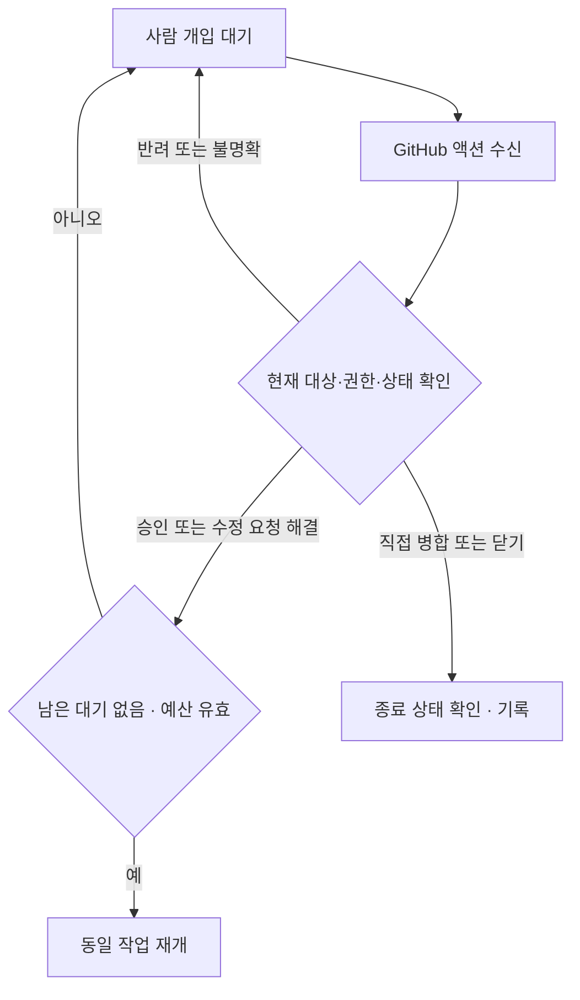

# 사람의 개입 표시와 GitHub 액션 처리

상태: 합의한 요구사항. 라벨 자동 동기화, 댓글 명령 처리, 이벤트 기반 재개는 아직 미구현이다.
일반 개발은 자율 수행하고, 실제로 사람의 판단이 필요한 작업만 눈에 띄게 표시한다.

## 사람에게 보이는 표시

| 라벨 | 뜻 | 사람이 할 행동 |
| --- | --- | --- |
| `momoflow:needs-review` | 사람의 코드 리뷰가 필요함 | PR에서 Approve 또는 Request changes |
| `momoflow:needs-decision` | 방향·권한·예산 등 결정이 필요함 | 연결된 결정 요청에 승인·반려·대안 회신 |
| `momoflow:ready` | 에이전트가 지금 실행할 수 있음 | 사람 개입 표시가 아닌 기존 실행 신호 |

원본 이슈와 연결 PR 양쪽에 필요한 개입 라벨을 표시한다. 본문에 언급된 모든 이슈로
전파하지 않는다. 여러 요청이 남았다면 하나가 해결되어도 해당 종류의 라벨을 유지한다.
개입 요청은 상단에 **필요한 판단, 추천안과 이유, 대상 버전, 응답 방법**을 적는다.
핵심 요청을 접힌 영역에 숨기지 않는다. 단순 CI 대기에는 사람 개입 라벨을 붙이지 않는다.

사람을 기다릴 때는 작업을 먼저 보존하고 원본 이슈의 `momoflow:ready`를 제거한다.
개입 라벨 자체는 현재 Symphony의 실행 차단 조건이 아니다. 실행 라벨이 남아 있으면
계속 실행될 수 있으므로 제거 결과를 확인한다.

## GitHub에서 한 행동의 의미

아래는 구현할 이벤트 처리 계약이다. 이벤트 처리 전 최신 이슈·PR·리뷰·검사 상태를
다시 읽어 실제 상태를 확정한다.

| 사람의 행동 | 이벤트·상태 | 처리 |
| --- | --- | --- |
| PR 승인 | `pull_request_review` submitted / approved | 현재 head와 필수 리뷰·검사를 재확인; 해결된 요청만 해제, 적격하면 재개 |
| 수정 요청 | 같은 이벤트 / changes_requested | 같은 이슈·PR에 수정 사항 기록; 다른 판단 대기가 없으면 예산 안에서 수정 실행 |
| 일반 리뷰·인라인 댓글 | commented / `pull_request_review_comment` | 피드백으로 기록; 승인이나 반려로 단정하지 않음 |
| 이슈·PR 대화 댓글 | `issue_comment` | 현재 결정 요청에 대한 명시적 응답인지 확인 |
| 직접 Merge 클릭 | `pull_request` closed 및 `merged=true` | 병합 사실·커밋 기록, 중복 병합·추가 구현 방지; 연결 이슈 완료 조건 재확인 |
| 병합 없이 PR 닫기 | 같은 이벤트 및 `merged=false` | 해당 PR 작업 중단; 성공으로 처리하거나 자동 재개하지 않음 |
| 이슈 닫기 | `issues` closed | 실행 대상에서 제외; 근거 없이 성공으로 표시하지 않음 |
| PR·이슈 다시 열기 | reopened | 의도와 예산 재평가; 무조건 실행 라벨을 붙이지 않음 |
| 승인 취소·댓글 수정·삭제·새 커밋 | dismissed / edited / deleted / synchronize | 판단의 유효성을 재계산; 오래된 승인을 새 요청·head에 재사용하지 않음 |

직접 병합은 배포 완료를 뜻하지 않는다. 검사를 우회한 병합이라면 실제 병합 사실은
기록하되 정상 검증 완료로 표시하지 않고 배포 자격을 별도로 판단한다.

## 댓글로 결정하기

PR 리뷰는 GitHub의 기본 Approve / Request changes를 우선 사용한다. 이슈 수준의
결정에는 다음과 같은 명시적 댓글을 지원하는 것을 초기 구현 목표로 한다.

```text
/momoflow approve D1
/momoflow reject D1 이유
```

이 명령은 아직 동작하지 않는다. `D1`은 해당 이슈 또는 PR 안에서 유일한 요청 ID이며,
요청 내용·버전·대상 head를 기록한다. 제안이 바뀌면 새 ID를 사용한다. 승인은 그 요청에만
한정되며 필수 PR 리뷰를 대체하지 않는다. 반려는 해당 제안의 중단이다. 대안이 없으면
개입 필요 상태를 유지하고, 대안이 명확하고 기존 범위에 포함될 때만 수정으로 전환한다.

“좋아요”, 이모지, 인용·코드 블록 속 명령은 자동 승인으로 처리하지 않는다. 자연어 회신은
근거로 보존하되 의미가 불명확하면 확인한다. 댓글 내용을 셸 명령으로 실행하지 않는다.

## 상태 확인과 기록



이벤트 ID와 처리 결과를 보존해 중복·순서 역전에도 중복 실행하지 않는다. 작성자, 원문
링크, 요청 ID 또는 PR head, 시각, 전후 상태를 작업 기록에 남긴다. 라벨은 표시이며
승인 근거가 아니다. 라벨을 지웠다는 이유만으로 승인되었다고 판단하지 않는다.

승인자는 저장소에서 판단 권한을 가진 사람이어야 한다. 자동화의 자기 승인은 허용하지
않는다. 기본 운영 인증은 사람의 개인 계정과 에이전트용 GitHub App으로 분리한다.
[인증 구성](../README.md)의 기존 개인 토큰 모드에서는 작성자만으로 둘을 확실히 구별할 수 없다.
앱 인증은 출처 구분의 기반일 뿐 승인 감지 구현 자체는 아니다. 이벤트 처리기는 앱의 자기 승인,
판단 권한 없는 사용자, 오래된 요청을 거절해야 한다. 같은 계정의 이벤트만으로 보호된 결정을
자동 해제하거나 사람임을 검증했다고 주장하지 않는다.

## 첫 구현의 완료 조건

- 개입 요청·해소가 원본 이슈와 PR의 라벨·상단 요약에 일관되게 표시된다.
- 승인, 수정 요청, 반려, 직접 병합, 병합 없는 닫기를 구분한다.
- 권한 없는 응답, 자기 승인, 오래된 head, 중복 이벤트가 재실행을 만들지 않는다.
- 다른 개입 요청이 남거나 예산이 소진되면 자동 재개하지 않는다.
- 처리 실패는 복구 가능한 근거를 남기고, 테스트는 외부 저장소 변경 없이 수행한다.

개발 에이전트가 작은 GitHub Actions 연결부터 구현한다. 별도 서비스나 범용 승인 엔진은
필요가 확인되기 전에 추가하지 않는다. 상세 원칙은 [GitHub 개선 흐름](github-flow.md)을 따른다.

참고: [GitHub 이벤트 안내](https://docs.github.com/en/actions/reference/workflows-and-actions/events-that-trigger-workflows),
[Webhook 이벤트와 payload](https://docs.github.com/en/webhooks/webhook-events-and-payloads).
