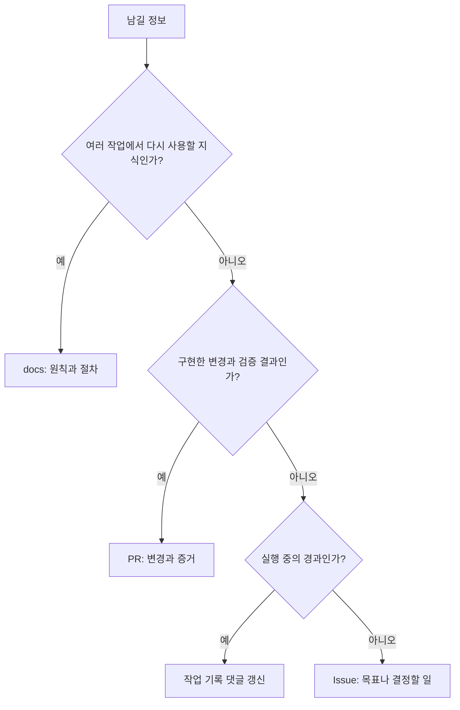

# 기록 위치와 읽기 쉬운 작성법

원칙: **지속되는 지식은 docs, 해야 할 일은 Issue, 변경의 증거는 PR, 실행 경과는 작업 기록**에 둔다.
원본은 한곳에 유지하고 나머지에서는 링크한다.

## 무엇을 어디에 남기는가

| 내용 | 원본 위치 | 남겨야 할 핵심 |
| --- | --- | --- |
| 제품 원칙·합의된 정책·운영 절차 | 해당 docs 문서 | 결정, 이유, 적용 범위, 현재 구현과의 차이 |
| 아직 결정하지 않은 설계 | Issue | 선택지, 판단 근거, 필요한 결정; 합의 후 docs 반영 |
| 결함·개선·기능 개발·자동화 작업 | Issue | 관찰 근거, 작은 목표, 범위, 완료 조건, 예산 |
| 변경 구현과 검증 결과 | PR | 이전/이후, 이슈 연결, 검사한 커밋, 증거, 위험·복구 |
| 반복 실행·대기·장애·다음 행동 | 이슈의 작업 기록 댓글 하나 | 현재 상태, 누적 반복 횟수, 근거 링크, 재개 조건 |
| 상세 테스트·빌드 로그 | CI 실행·아티팩트 | 본문에는 결과 요약과 링크; 보존 기간 고려 |
| 배포 결과 | 배포 기록 또는 연결된 운영 Issue | 배포 정책에서 요구하는 버전·검사·복구 근거 |
| 후속 개선 | 별도 Issue | 부모 이슈·PR, 새로 발견한 문제, 완료 조건 |

로드맵은 방향과 소수의 후보를 담는다. 실행할 만큼 구체적인 후보는 Issue로 옮기고
로드맵에서는 그 이슈를 링크한다. 모든 실행 경과를 docs에 복제하거나 작업마다 새 문서를
만들지 않는다. 작은 결함 수정에 새 설계 문서는 필요하지 않다.

## 한 화면에서 판단할 수 있게

- 첫 문장은 문제나 결과를 한두 문장으로 요약한다. 작업 과정을 시간순으로 길게 나열하지 않는다.
- 비교는 이전/이후 표, 검증은 결과·근거 표, 완료 조건은 체크리스트로 쓴다.
- 흐름·분기·상호작용이 글보다 명확해질 때 Mermaid를 사용한다. 단순 변경에는 생략한다.
- 그림은 한 가지 질문에 답하고 약 5~8개 노드로 제한한다. 계획과 현재 동작을 구분하며
  검증되지 않은 자동화가 이미 동작하는 것처럼 그리지 않는다.
- 상태는 `통과`, `실패`, `미실행`, `해당 없음`처럼 글자로 표시한다. 색이나 아이콘만으로 구분하지 않는다.
- 상세 로그·재현 자료는 `
`로 접거나 링크한다. 핵심 오류와 필요한 사람의 판단은 접지 않는다.
- 사람 개입이 필요하면 [개입 라벨과 액션 규칙](human-actions.md)에 따라 요청·응답 방법을 상단에 표시한다.
- 비밀 값·인증 파일·불필요한 개인정보는 본문, 로그, 그림에 넣지 않는다.
- 선택 항목과 안내 문구는 제출 전에 삭제한다. 빈 템플릿이나 미실행 체크박스를 성공 근거로 쓰지 않는다.

## 템플릿 적용

| 작성 대상 | 사용할 템플릿 |
| --- | --- |
| 개선·결함·운영 작업 Issue | [이슈 템플릿](../.github/ISSUE_TEMPLATE/improvement.md) |
| PR | [PR 템플릿](../.github/pull_request_template.md) |
| 실행 중 작업 기록 댓글 | [작업 기록 템플릿](templates/workpad.md) |

GitHub 웹 UI에서 사용할 템플릿 파일과 에이전트가 읽을 Markdown을 동일하게 사용한다.
API나 CLI로 생성하는 에이전트도 해당 템플릿을 읽고 채운 본문을 전송해야 한다. API 호출에
템플릿이 자동 적용된다고 가정하지 않는다. 이슈 템플릿의 YAML front matter는 본문에서 제외한다.

기본 브랜치에 반영하기 전에는 GitHub 웹 UI에 템플릿이 표시되지 않는다. 이 템플릿들은
작성 규칙이며 필수 필드나 실행 예산을 강제하는 자동 검증 기능은 아니다. 자동 실행 라벨은
템플릿에서 부여하지 않는다. 후속 이슈의 실행 승격은 기존 워크플로 정책을 따른다.

## 갱신과 인계

1. 실행 전에 이슈·기존 작업 기록·연결 PR을 찾아 중복 생성을 피한다.
2. 중요한 상태 변화마다 같은 작업 기록 댓글을 갱신한다. 반복 횟수와 이전 검증 근거는 보존한다.
3. PR은 최종 변경을 기준으로 요약을 갱신하고 검사한 커밋을 기록한다. 커밋이 바뀌면
   이전 검증을 현재 커밋의 성공으로 표시하지 않는다.
4. 재사용할 결정이나 절차가 생겼으면 같은 PR에서 해당 docs를 갱신하고 이슈에 링크한다.
5. 배포는 병합과 구분해 기록한다. 후속 개선이 없으면 `없음`으로 끝내도 된다.

참고: [GitHub 템플릿 안내](https://docs.github.com/en/communities/using-templates-to-encourage-useful-issues-and-pull-requests/about-issue-and-pull-request-templates),
[Mermaid 다이어그램 안내](https://docs.github.com/en/get-started/writing-on-github/working-with-advanced-formatting/creating-diagrams).
